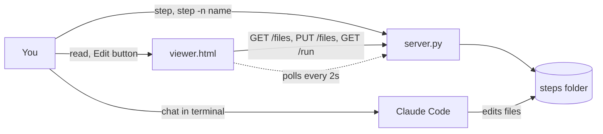

# Architecture

## Files

| File | Role |
|------|------|
| `index.md` | Ordered list of steps: `- [Title](file)` |
| `NN-name.md` | A markdown step |
| `NN-name.py` | A runnable step (code shown, Run button) |
| `step_viewer/viewer.html` | Static page: fetch, render, navigate, poll |
| `step_viewer/server.py` | The `step` command: parses arguments, creates new notes, serves the page, the file list and files, saves edits, runs `.py` files |
| `install.py` | Local, per-user install: writes one `step` launcher file (`--remove` deletes it), Linux and Windows |

## Server endpoints

| Endpoint | What it does |
|----------|--------------|
| `GET /` | the viewer page |
| `GET /tree` | list of viewable files under the served folder (the File dropdown) |
| `GET /files/<path>` | read a file under the served folder |
| `PUT /files/<path>` | overwrite an existing file (Edit, Save) |
| `GET /run?file=x.py` | run a `.py` file from its own folder (10s timeout), return output |

The served folder is the current directory by default, the folder given on the command line, or the notes directory with `-n` (`$STEP_NOTES`, default `~/notes`). `step -n NAME` first creates `<date>-<name>.md` (or a folder with `-d`) there if it does not exist, and opens the browser on it. Requests whose `Host` header is not `127.0.0.1:<port>` or `localhost:<port>` get 403 (DNS rebinding guard).

## Edit and interact

- **Interact:** you talk to Claude in the terminal, quoting the header, for example `2/5 · 02-architecture.md`. Claude edits the file and the viewer updates within 2 seconds.
- **Edit:** your own editor on the same files, or the Edit button (textarea, Save writes the file).

## Known limits

- `/run` executes any `.py` under the served folder, and Save overwrites any listed file there, with no sandbox. The server binds to `127.0.0.1` only. Do not expose it.
- Picking an `.md` file shows its steps (`index.md` links, or `## ` sections), not its raw text, so edit those files in your editor or ask Claude.
- Polling re-reads every step file every 2 seconds. Fine for a handful of small files.
- In single-file `.md` mode the Edit button edits only the current section. Save splices that section back into the full file, and refuses (with a message) if the section text no longer matches the file on disk.
